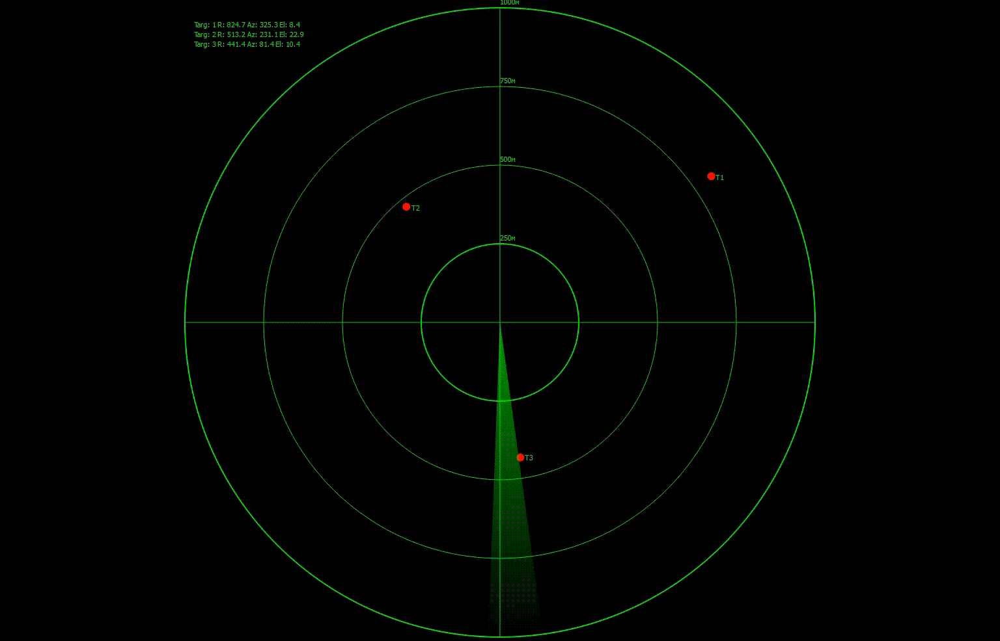

# 2D Radar

Учебный проект на C++ и Qt Widgets: имитация кругового обзорного радара. Вращающийся луч обнаруживает движущиеся цели, на экране отображаются дальность, азимут и угол места, а также траектория движения каждой цели.



## Возможности

- Вращающийся луч обзора с настраиваемой скоростью вращения и шириной сектора.
- Несколько целей, движущихся с постоянной скоростью по осям X/Y/Z.
- Расчёт радиолокационных измерений: наклонная дальность, азимут, угол места (`Radar/RadarMeasurements`).
- Подсветка цели жёлтым в момент, когда её накрывает луч, и запись события обнаружения в лог (`qDebug`), один раз за проход луча.
- Траектория движения каждой цели — пунктирная линия, ограниченная по длине и обрезанная по кругу радара.
- Кольца дальности с подписями в метрах и перекрестие осей.
- Выбор цели кликом мыши: показывается информационная панель (дальность, азимут, угол места, составляющие скорости). Клик по пустому месту снимает выделение.
- Движение целей и вращение луча синхронизированы с реальным временем кадра (`QElapsedTimer`), а не с фиксированным шагом.

## Структура проекта

```
2D_Radar/
├── main.cpp                   # Точка входа, создаёт и показывает RadarWidget
├── mainwindow.{h,cpp,ui}      # Заготовка главного окна Qt Designer (пока не используется)
├── icons.qrc, radar_icon.jpg  # Иконка приложения
├── Radar/
│   ├── RadarWidget.{h,cpp}        # Виджет радара: отрисовка, симуляция, обработка мыши
│   └── RadarMeasurements.{h,cpp}  # Структура RadarMeasurement и calcMeasurements()
├── Target/
│   └── target.{h,cpp}         # Класс Target: координаты, скорость, история траектории
└── CMakeLists.txt             # Сборка через CMake, Qt5 или Qt6 (Widgets)
```

## Требования

- CMake ≥ 3.16
- Компилятор с поддержкой C++17
- Qt 5 или Qt 6, модуль Widgets

Разработка и сборка ведётся в Qt Creator (MinGW + статический Qt 5.15 через MSYS2), но проект собирается и обычным CMake-тулчейном.

## Сборка и запуск

### В Qt Creator
Открыть `CMakeLists.txt` как проект, выбрать Kit с Qt Widgets и собрать (Ctrl+B) / запустить (Ctrl+R).

### Из командной строки
```
cmake -S . -B build
cmake --build build
```
Исполняемый файл `Radar_2D` (на Windows — `Radar_2D.exe`) появится в папке `build`.

## Управление

- Клик по цели на экране — выбрать её и показать подробную информацию.
- Клик по пустому месту — снять выделение.

## Планы по развитию

- Вынести параметры радара (дальность, ширина и скорость луча) из `RadarWidget` в отдельный класс `Radar`.
- Добавить шум измерений и вероятность обнаружения, зависящую от дальности.
- Реализовать сопровождение целей (построение треков по отметкам, фильтр Калмана).
- Панель управления сценарием: скорость вращения, количество и параметры целей.
- Автотесты на расчёт измерений и логику обнаружения.
